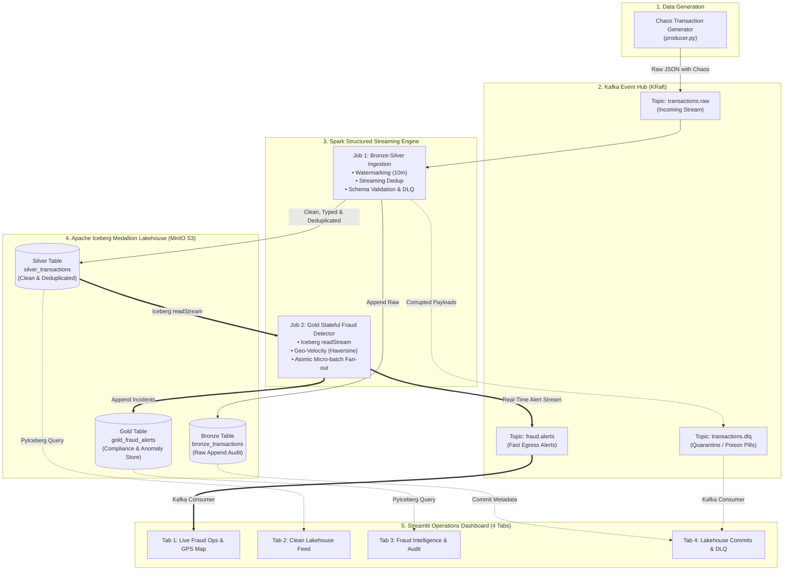

# Real-Time Fraud & Anomaly Detection Lakehouse

[](https://www.python.org/)
[](https://spark.apache.org/)
[](https://iceberg.apache.org/)
[](https://kafka.apache.org/)
[](https://github.com/astral-sh/uv)
[](tests/)

A production-grade streaming platform designed to demonstrate advanced **Spark Structured Streaming**, **Apache Iceberg**, and **Medallion Lakehouse Architecture**.

---

## 🎯 Architecture Overview & Component Inventory



### Component Inventory

| Component | Count | Names & Resource Details |
| :--- | :---: | :--- |
| **Kafka Topics** | **3** | `transactions.raw` (source), `transactions.dlq` (quarantine), `fraud.alerts` (egress alerts) |
| **Spark Streaming Jobs** | **2** | `job_bronze_silver.py` (Bronze, Silver & DLQ), `job_gold_fraud_detector.py` (Gold & Alerts) |
| **Iceberg Tables** | **3** | `bronze_transactions`, `silver_transactions`, `gold_fraud_alerts` (MinIO S3 + REST Catalog) |
| **Dashboard** | **1** | Unified Streamlit Web App (4 interactive operational tabs on `:8501`) |

---

## 💡 Lead Data Engineer Assessment: Streaming Patterns & Interview Runbook

This project directly answers critical architectural trade-offs expected of a **Lead Data Engineer / Tech Lead**:

### 1. Watermarking & Late Data Handling
- **The Challenge**: Streaming data over networks arrives late and out-of-order. Indefinitely caching state leads to executor `OutOfMemoryError`.
- **Implementation**: We define `.withWatermark("event_time", "10 minutes")` in [`src/jobs/job_bronze_silver.py`](src/jobs/job_bronze_silver.py). Spark tracks the event-time watermark monotonically and drops events lagging by more than 10 minutes from state memory, maintaining a bounded state store.

### 2. Streaming Deduplication (Exactly-Once Semantics)
- **The Challenge**: Payment processors retry failed network transmissions, injecting duplicate `transaction_id`s.
- **Implementation**: Bounded deduplication using `.dropDuplicates(["transaction_id", "event_time"])`. By pairing the business primary key with the watermarked event timestamp, Spark retains deduplication keys only within the active 10-minute watermark window, discarding expired keys automatically.

### 3. Stateful Geo-Velocity Processing (Impossible Travel)
- **The Challenge**: Calculating distance and speed between consecutive events per user ($T_1 \rightarrow T_2$) across streaming micro-batches without non-time window limitations in Spark Streaming.
- **Implementation**:
  - **State Warming from Iceberg**: On job startup, [`src/jobs/job_gold_fraud_detector.py`](src/jobs/job_gold_fraud_detector.py) warms an in-memory user cache with the latest known location per user directly from `silver_transactions`.
  - **Cross-Batch Windowing**: Preceding user states are unioned into the batch with an `is_prior` flag, allowing standard PySpark `lag()` over `Window.partitionBy("user_id").orderBy("event_time")` to evaluate both intra-batch and cross-batch transactions seamlessly.
  - **Pure PySpark SQL Haversine**: Computed via native Spark SQL mathematical expressions (`radians`, `sin`, `cos`, `asin`), executing directly inside the JVM without Python UDF serialization bottlenecks.
  - **Anomaly Rule**: Flags transactions exceeding commercial aviation capabilities ($>800\text{ km/h}$ over $>500\text{ km}$).

### 4. Dead-Letter Queue (DLQ) Architectural Trade-Off
- **Trade-off Decision**: Operational Kafka topic (`transactions.dlq`) vs. Analytical Lakehouse table (`quarantine_dlq`).
- **Resolution**: We write corrupted records and schema violations directly to Kafka topic **`transactions.dlq`**. This enables upstream teams to fix parsing bugs and **replay the DLQ back into the pipeline** without requiring storage mutations or lakehouse rewrites.

### 5. Multi-Sink Atomic Fan-Out (`foreachBatch`)
- **The Challenge**: Fanning out alerts to both a high-throughput messaging queue (Kafka `fraud.alerts`) and an analytical ACID table (Iceberg `gold_fraud_alerts`) without recomputing the stream twice.
- **Implementation**: We leverage `writeStream.foreachBatch(...)`. The streaming micro-batch is evaluated once, and the resulting `alerts_df` is written concurrently to Kafka and appended to Iceberg.

### 6. Shuffle Partitions Performance Tuning
- **The Challenge**: Default Spark configuration sets `spark.sql.shuffle.partitions = 200`. In micro-batch streaming with small batches, 200 tasks create massive task scheduling overhead (~40s micro-batch latency).
- **Optimization**: Setting `spark.sql.shuffle.partitions = 4` in [`src/lakehouse/spark_session.py`](src/lakehouse/spark_session.py) reduced micro-batch execution latency from **40 seconds down to 2 seconds**!

---

## 🖥️ Streamlit 4-Tab Real-Time Dashboard

The interactive operations dashboard is accessible on `http://localhost:8501`:

- **Tab 1: 🚨 Live Fraud Ops & Map**: Consumes Kafka topic `fraud.alerts`, displays real-time KPI metrics (critical vs. high alerts, prevented financial loss), plots anomaly coordinates on an interactive global map, and streams alert cards.
- **Tab 2: 💎 Clean Silver Feed**: Queries the Iceberg `silver_transactions` table via PyIceberg, featuring full-text search by User ID, category filtering (travel, groceries, electronics), and volume metrics.
- **Tab 3: 📊 Fraud Intelligence & Audit**: Compliance audit center pulling historical data from `gold_fraud_alerts`, displaying average fraud amounts, anomaly breakdown charts, and high-risk corridor distributions.
- **Tab 4: ⚙️ Lakehouse Commits & DLQ**: Real-time lakehouse internals explorer showing Apache Iceberg ACID commit snapshot histories (snapshot ID, timestamps, operations) alongside the Kafka Dead-Letter Queue (`transactions.dlq`) inspector.

---

## ⚡ Quickstart & One-Click Demo

### 1. Prerequisites
- **Python >= 3.13** managed via [uv](https://github.com/astral-sh/uv)
- **Docker Desktop**

### 2. Environment Setup
```bash
# Clone the repository
git clone https://github.com/Salatich/spark-streaming-fraud-detection.git
cd spark-streaming

# Install dependencies deterministically via uv
uv sync
```

### 3. Start Infrastructure
```bash
# Start Kafka, MinIO, Iceberg REST, Kafka UI, and Spark Engine
docker compose up -d

# Verify infrastructure health
uv run python scripts/verify_infra.py
```

### 4. Run One-Click End-to-End Demo
Run the automated end-to-end sandbox script:
```bash
uv run python scripts/run_demo.py
```
This script automatically:
1. Emits streaming financial transactions with injected chaos (impossible travel, late arrivals, duplicates, poison pills).
2. Executes Spark Job 1 (Bronze Ingest, Silver Cleanse & Watermarking, DLQ Routing).
3. Executes Spark Job 2 (Iceberg streaming read, Geo-Velocity Engine, Dual-Sink Egress).

### 5. Launch the Dashboard
```bash
uv run streamlit run src/ui/app.py
```

---

## 🧪 Testing & Code Quality

The repository includes a comprehensive unit test suite covering Pydantic models, chaos generator mechanics, impossible travel physics, and UI metadata helpers.

```bash
# Run 15/15 unit tests
uv run pytest

# Verify code formatting and linting
uv run ruff check src tests
uv run ruff format --check src tests
```

---

## 📁 Repository Structure

```
├── docker/
│   ├── Dockerfile.spark          # Custom Spark 3.5.3 + Iceberg 1.6.1 + AWS S3 bundles
│   └── entrypoint.sh             # Spark daemon entrypoint
├── docker-compose.yml            # Kafka (KRaft), MinIO, Iceberg REST, Kafka UI, Spark Engine
├── scripts/
│   ├── run_demo.py               # One-click end-to-end pipeline demonstration script
│   └── verify_infra.py           # Infrastructure health check script
├── src/
│   ├── generator/                # Chaos transaction producer & Haversine geo utilities
│   │   ├── geo_utils.py          # Great-circle distance calculations & city coordinates
│   │   └── producer.py           # Synthetic generator with configurable chaos injection
│   ├── jobs/                     # Spark Structured Streaming production jobs
│   │   ├── job_bronze_silver.py  # Bronze ingestion, watermarked dedup, and DLQ routing
│   │   └── job_gold_fraud_detector.py # Stateful fraud engine with Iceberg readStream & dual-sink
│   ├── lakehouse/                # Lakehouse table schemas and SparkSession factory
│   │   ├── spark_session.py      # Pre-configured SparkSession with S3A and Iceberg Catalog
│   │   └── table_schemas.py      # Iceberg DDL definitions with hidden partitioning
│   ├── models/                   # Pydantic domain models
│   │   └── transaction.py        # TransactionEvent, FraudAlert, DLQRecord, GeoLocation
│   └── ui/                       # Streamlit real-time operational dashboard
│       ├── app.py                # 4-tab Streamlit web application
│       ├── iceberg_client.py     # PyIceberg catalog & snapshot metadata client
│       └── kafka_client.py       # Confluent Kafka consumer client
├── tests/                        # Full automated test suite (15 tests)
│   ├── test_generator.py         # Generator structure & chaos probability tests
│   ├── test_gold_fraud_detector.py # Impossible travel & velocity burst physics tests
│   ├── test_models.py            # Pydantic validation & JSON serialization tests
│   └── test_ui.py                # Dashboard client & metadata tests
├── pyproject.toml                # Project metadata & pinned dependencies (Python 3.13)
├── uv.lock                       # Deterministic lockfile
└── README.md                     # Architecture guide & interview runbook
```
