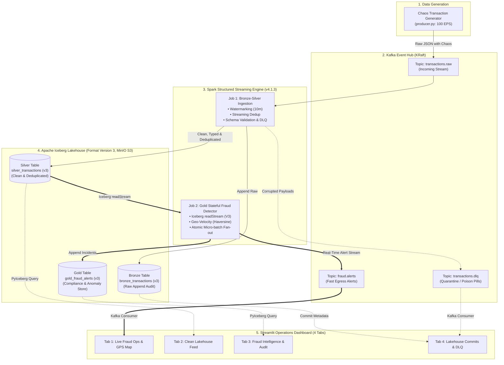

# Real-Time Fraud & Anomaly Detection Lakehouse

[](https://www.python.org/)
[](https://spark.apache.org/)
[-blue.svg)](https://iceberg.apache.org/)
[](https://kafka.apache.org/)
[](https://github.com/astral-sh/uv)
[](tests/)

A production-grade streaming platform demonstrating modern **Apache Spark 4.1.3 Structured Streaming**, **Apache Iceberg 1.12.0 Format Version 3 (v3)**, and **Medallion Lakehouse Architecture**.

---

## 🎯 Architecture Overview & Component Inventory



### Component Inventory

| Component | Count | Names & Resource Details |
| :--- | :---: | :--- |
| **Kafka Topics** | **3** | `transactions.raw` (source), `transactions.dlq` (quarantine), `fraud.alerts` (egress alerts) |
| **Spark Streaming Jobs** | **2** | `job_bronze_silver.py` (Bronze, Silver & DLQ), `job_gold_fraud_detector.py` (Gold & Alerts) |
| **Iceberg Tables** | **3** | `bronze_transactions`, `silver_transactions`, `gold_fraud_alerts` (**Format Version 3**, MinIO S3 + REST Catalog) |
| **REST Catalog** | **1** | Official `apache/iceberg-rest-fixture:latest` supporting Iceberg Format Version 3 |
| **Dashboard** | **1** | Unified Streamlit Web App (4 interactive operational tabs on `:8501`) |

---

## 💡 Modernization & Engineering Highlights (Spark 4.1.3 + Iceberg 1.12.0)

### 1. Apache Iceberg Format Version 3 (v3) Tables
- **Table Definition**: Configured with `TBLPROPERTIES ('format-version' = '3')` for all three Medallion tables (`bronze_transactions`, `silver_transactions`, `gold_fraud_alerts`).
- **REST Catalog Migration**: Replaced archived `tabulario/iceberg-rest` (which rejected v3 with `Unsupported format version: v3 (supported: v2)`) with the official Apache Foundation image **`apache/iceberg-rest-fixture:latest`**.
- **Capabilities**: Enables Iceberg v3 advanced features including row-level deletes, default values, nanosecond timestamps, and schema evolution.

### 2. PySpark 4.1.3 API Modernizations
- **ANSI SQL Divide-by-Zero Safety**: Spark 4.1 ANSI mode strictly rejects divisions by zero (`DIVIDE_BY_ZERO` error). The Haversine speed calculation in [`src/jobs/job_gold_fraud_detector.py`](src/jobs/job_gold_fraud_detector.py) uses conditional branching:
  ```python
  speed_kmh = when(
      col("prev_lat").isNotNull() & (time_delta_sec > 0),
      distance_km / (time_delta_sec / 3600.0),
  ).otherwise(lit(0.0))
  ```
- **Micro-Batch Suppression (`noDataMicroBatches`)**: Configured `spark.sql.streaming.noDataMicroBatches.enabled = false` in [`src/lakehouse/spark_session.py`](src/lakehouse/spark_session.py) to eliminate empty micro-batch execution and reduce S3/MinIO commit pressure.
- **Hadoop 3.4.2 & AWS SDK v2**: Spark 4.1.3 bundles Hadoop 3.4.2, which utilizes the AWS SDK v2 bundle (`software.amazon.awssdk:bundle:2.29.52.jar` and `hadoop-aws-3.4.2.jar`) instead of obsolete AWS SDK v1 jars.

### 3. Real-Time Mode (RTM) vs. Micro-Batching in Lakehouses
- **Spark 4.1 Real-Time Mode (`Trigger.RealTime`)**: Evaluated for low-latency operational streams.
- **Why Lakehouse Tables Use Micro-Batches**: Spark 4.1's `RealTimeModeAllowlist` restricts RTM to Kafka, Memory, and Console sinks, rejecting lakehouse tables (`SparkTable`) with `STREAMING_REAL_TIME_MODE.OPERATOR_OR_SINK_NOT_IN_ALLOWLIST` because sub-millisecond commits create file fragmentation. Therefore, a **5-second micro-batch trigger** is the optimal design pattern for ACID Parquet generation.
- **Where RTM Excels**: Verified running cleanly for pure Kafka-to-Kafka streams (e.g., dead-letter quarantine and alert forwarding).

---

## 💡 Streaming Patterns & Interview Runbook

### 1. Watermarking & Late Data Handling
- **The Challenge**: Streaming data over networks arrives late and out-of-order. Indefinitely caching state leads to executor `OutOfMemoryError`.
- **Implementation**: We define `.withWatermark("event_time", "10 minutes")` in [`src/jobs/job_bronze_silver.py`](src/jobs/job_bronze_silver.py). Spark tracks the event-time watermark monotonically and drops events lagging by more than 10 minutes from state memory, maintaining a bounded state store.

### 2. Streaming Deduplication (Exactly-Once Semantics)
- **The Challenge**: Payment processors retry failed network transmissions, injecting duplicate `transaction_id`s.
- **Implementation**: Bounded deduplication using `.dropDuplicates(["transaction_id", "event_time"])`. By pairing the business primary key with the watermarked event timestamp, Spark retains deduplication keys only within the active 10-minute watermark window, discarding expired keys automatically.

### 3. Stateful Geo-Velocity Processing (Impossible Travel)
- **The Challenge**: Calculating distance and speed between consecutive events per user across streaming micro-batches.
- **Implementation**:
  - **State Warming from Iceberg**: On startup, [`src/jobs/job_gold_fraud_detector.py`](src/jobs/job_gold_fraud_detector.py) warms driver cache from the latest known location per user directly from `silver_transactions`.
  - **Cross-Batch Windowing**: Preceding user states are unioned into the batch with an `is_prior` flag, allowing standard PySpark `lag()` over `Window.partitionBy("user_id").orderBy("event_time")` to evaluate transactions across micro-batch boundaries.
  - **Pure PySpark SQL Haversine**: Computed via native Spark SQL expressions (`radians`, `sin`, `cos`, `asin`), executing inside the JVM without Python UDF serialization bottlenecks.
  - **Anomaly Rules**: Flags impossible travel ($>800\text{ km/h}$ over $>500\text{ km}$) and velocity bursts ($\le 60\text{s}$ over $\$200$).

### 4. Multi-Sink Atomic Fan-Out (`foreachBatch`)
- **The Challenge**: Fanning out alerts to both an operational queue (Kafka `fraud.alerts`) and an analytical ACID table (Iceberg `gold_fraud_alerts`) without re-evaluating the stream twice.
- **Implementation**: `writeStream.foreachBatch(...)` evaluates the micro-batch once and writes concurrently to Kafka and Iceberg.

---

## 🖥️ Streamlit 4-Tab Real-Time Dashboard

The interactive operations dashboard is accessible on `http://localhost:8501`:

- **Tab 1: 🚨 Live Fraud Ops & Map**: Consumes Kafka topic `fraud.alerts`, displays real-time KPI metrics, plots anomaly coordinates on an interactive global map, and streams alert cards.
- **Tab 2: 💎 Clean Silver Feed**: Queries Iceberg `silver_transactions` via PyIceberg, featuring category filtering and User ID search.
- **Tab 3: 📊 Fraud Intelligence & Audit**: Compliance audit center pulling historical data from `gold_fraud_alerts`, displaying average fraud amounts and anomaly charts.
- **Tab 4: ⚙️ Lakehouse Commits & DLQ**: Real-time lakehouse explorer showing Apache Iceberg ACID commit snapshot histories alongside the Kafka Dead-Letter Queue (`transactions.dlq`) inspector.

---

## ⚡ Quickstart & One-Click Demo

### 1. Prerequisites
- **Python >= 3.13** managed via [uv](https://github.com/astral-sh/uv)
- **Docker Desktop**

### 2. Environment Setup
```bash
# Clone the repository
git clone https://github.com/Salatich/spark-streaming-fraud-detection.git
cd spark-streaming

# Install dependencies deterministically via uv
uv sync
```

### 3. Start Infrastructure
```bash
# Start Kafka (KRaft), MinIO, Iceberg REST (v3), Kafka UI, and Spark Engine (4.1.3)
docker compose up -d

# Verify infrastructure connectivity and health
uv run python scripts/verify_infra.py
```

### 4. Run One-Click End-to-End Demo
Run the automated end-to-end sandbox runner:
```bash
uv run python scripts/run_demo.py
```
This script automatically:
1. Emits streaming financial transactions with chaos (impossible travel, late arrivals, duplicates, poison pills).
2. Executes Spark Job 1 in batch mode (`--once`, Trigger.AvailableNow).
3. Executes Spark Job 2 in batch mode (`--once`, Trigger.AvailableNow).

### 5. Launch the Dashboard
```bash
uv run streamlit run src/ui/app.py
```
Open [http://localhost:8501](http://localhost:8501) in your browser.

---

## 🧪 Testing & Code Quality

The repository includes a comprehensive unit test suite covering Pydantic models, chaos generator mechanics, impossible travel physics, and UI metadata helpers.

```bash
# Run all unit tests (15/15 passing)
uv run pytest

# Verify code formatting and linting (100% clean)
uv run ruff check .
```

---

## 📁 Repository Structure

```
├── docker/
│   ├── Dockerfile.spark          # Custom Spark 4.1.3 + Iceberg 1.12.0 + AWS SDK v2 bundles
│   └── entrypoint.sh             # Spark container entrypoint
├── docker-compose.yml            # Kafka (KRaft), MinIO, Iceberg REST (v3), Kafka UI, Spark Engine
├── scripts/
│   ├── run_demo.py               # One-click end-to-end demonstration script
│   └── verify_infra.py           # Infrastructure health check script
├── src/
│   ├── generator/                # Chaos transaction producer & Haversine geo utilities
│   │   ├── geo_utils.py          # Great-circle distance calculations & city coordinates
│   │   └── producer.py           # Synthetic generator with configurable chaos injection (100 EPS)
│   ├── jobs/                     # Spark Structured Streaming production jobs
│   │   ├── job_bronze_silver.py  # Bronze ingestion, watermarked dedup, and DLQ routing
│   │   └── job_gold_fraud_detector.py # Stateful fraud engine with Iceberg readStream & dual-sink
│   ├── lakehouse/                # Lakehouse table schemas and SparkSession factory
│   │   ├── spark_session.py      # Pre-configured SparkSession with S3A and Iceberg Catalog
│   │   └── table_schemas.py      # Iceberg Format Version 3 DDL definitions
│   ├── models/                   # Pydantic domain models
│   │   └── transaction.py        # TransactionEvent, FraudAlert, DLQRecord, GeoLocation
│   └── ui/                       # Streamlit real-time operational dashboard
│       ├── app.py                # 4-tab Streamlit web application
│       ├── iceberg_client.py     # PyIceberg catalog & snapshot metadata client
│       └── kafka_client.py       # Confluent Kafka consumer client
├── tests/                        # Full automated test suite (15 tests)
│   ├── test_generator.py         # Generator structure & chaos probability tests
│   ├── test_gold_fraud_detector.py # Impossible travel & velocity burst physics tests
│   ├── test_models.py            # Pydantic validation & JSON serialization tests
│   └── test_ui.py                # Dashboard client & metadata tests
├── pyproject.toml                # Project metadata, pinned dependencies & tool settings
├── uv.lock                       # Deterministic lockfile
└── README.md                     # Architecture guide & interview runbook
```
